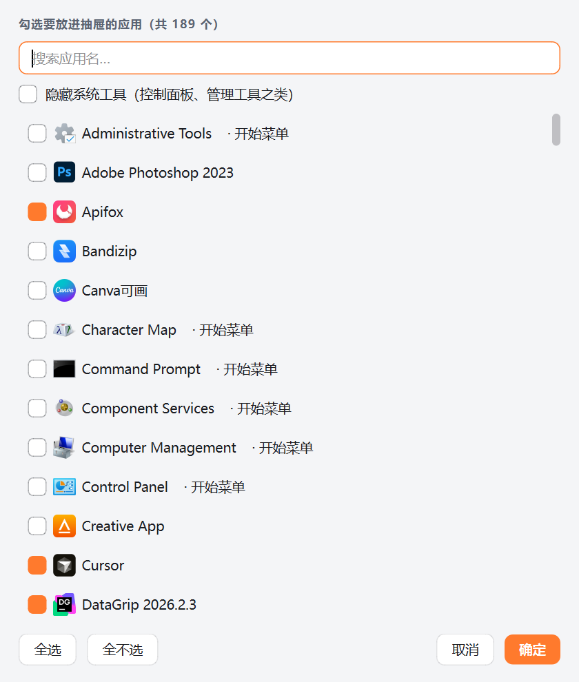
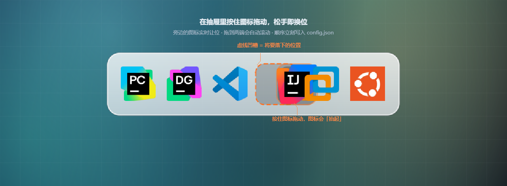
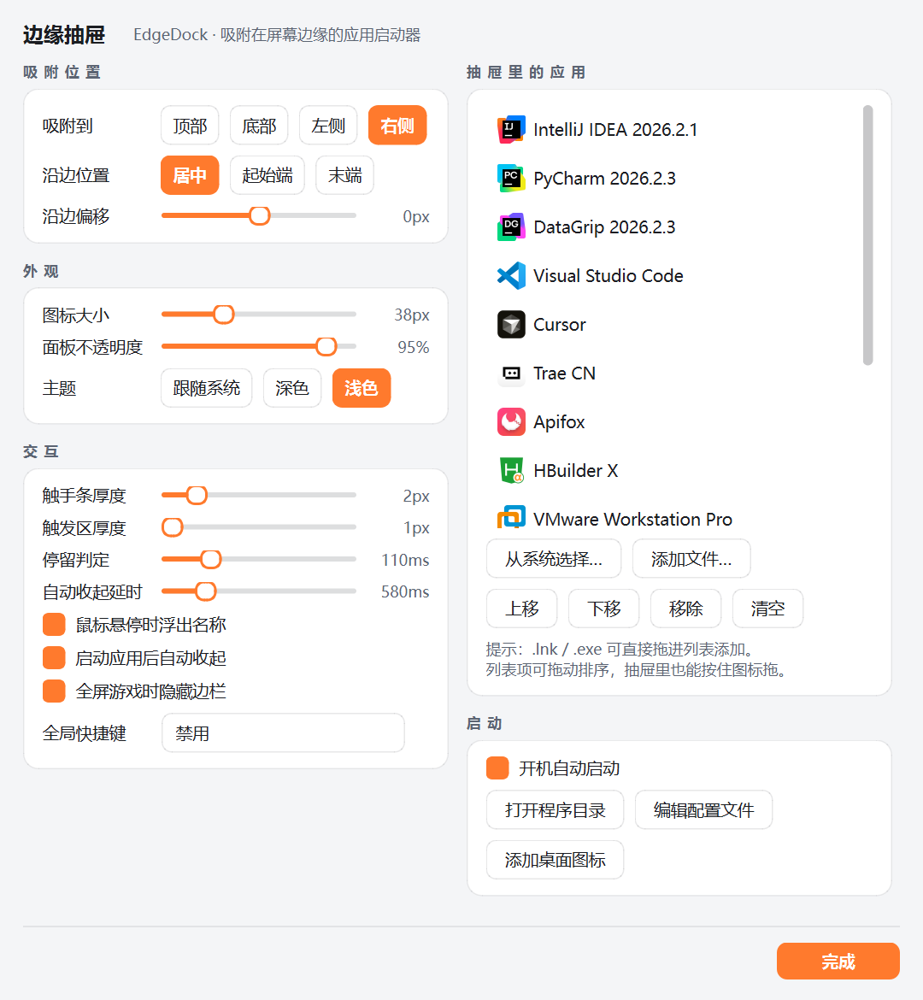

# EdgeDock · 边缘抽屉

一条**吸附在屏幕边缘的应用启动器**：平时只剩一道极细的光痕，鼠标碰到屏幕边缘它就滑出来，
移开鼠标自动收回。展开时**只显示图标**，清清爽爽。

它认的是**系统里装了什么**，不是桌面上摆了什么东西 —— 所以桌面可以彻底空着。
要加应用，从「所有应用」里挑（带搜索），不用去桌面翻快捷方式。

```
                    ╭──────────────────────────────────────────────╮
  收起时  ▔▔▔▔▔▔▔▔▔▔▔▔▔▔▔▔▔▔▔▔▔▔▔▔▔▔▔▔▔▔▔▔▔▔▔▔▔▔▔▔▔▔   ← 4px 琥珀橙光痕
                    ╰──────────────────────────────────────────────╯
  展开时  ╭──────────────────────────────────────────╮
          │  IJ   PC   DG   VS   VM   🟠   AI   Ps  │   ← 只显示图标
          ╰──────────────────────────────────────────╯
```

---

## 一、运行

双击 **`启动 EdgeDock.vbs`**（静默启动，不弹黑窗口）。

首次启动会扫描**系统应用目录**（Windows 的「所有应用」，本机 192 个），挑出常用的开发工具
放进抽屉，并在托盘弹一条提示。**如果自动挑得不对，右键托盘图标 →「设置…」→ 从系统选择…** 自己勾。

> 想开机就自动运行：托盘右键 → 勾上「开机自动启动」。

「所有应用」这一份目录同时覆盖**商店应用**和传统程序，是唯一能把计算器、截图工具这类
UWP 应用也收进来的来源。桌面和「开始」菜单作为补充，同名的不会重复出现。

---

## 二、怎么用

| 操作 | 效果 |
| --- | --- |
| 鼠标**碰一下屏幕吸附的那条边** | 抽屉滑出（默认吸附在**顶部**） |
| 鼠标**移开抽屉** | 约 0.7 秒后自动收回 |
| **左键单击图标** | 启动该应用，然后抽屉自动收起 |
| **鼠标悬停在图标上** | 图标放大 + 浮出应用名 |
| **右键单击图标** | 打开 / 打开文件所在位置 / 移到最前 / 移到最后 / 从抽屉移除 / 设置 / 退出 |
| **右键单击抽屉空白处** | 固定展开 / 设置 / 退出 |
| **滚轮** | 图标太多时横向（或纵向）滚动 |
| **按住图标拖到别的位置** | 图标跟着走，松手即换位（**直接调顺序**） |
| **从桌面拖一个快捷方式到屏幕边缘** | 抽屉自动滑出并高亮，松手即加入抽屉（仍然支持） |
| **Ctrl + Alt + D** | 唤出 / 收起抽屉（可在设置里改） |
| **左键单击托盘图标** | 唤出 / 收起抽屉 |
| **右键单击托盘图标** | 主菜单 |

装不下的时候会自动出现滚动，**图标数量不固定，想加多少加多少**。

**打游戏的时候它会自己让开**：全屏游戏（含无边框窗口化）、全屏视频、全屏演示一占住屏幕，
边栏就整条藏起来，鼠标甩到边缘也不会冒出来；退出全屏立刻回来，位置、滚动位置、
钉住状态都跟之前一样。判据是「前台窗口盖满整块显示器且不带标题栏」，
**最大化的浏览器 / 资源管理器不会误伤**（它们贴的是工作区，任务栏还露着）。
不需要的话，设置 → 交互 → 取消「全屏游戏时隐藏边栏」。

### 从系统里挑应用

设置 → 右列「抽屉里的应用」→ **从系统选择…**，弹出一个带搜索框的应用列表：



- 列出这台机器上能启动的**全部应用**（商店应用 + 传统程序 + 开始菜单 + 桌面，去重后按名字排序）
- **隐藏系统工具**开关（默认开）：控制面板、管理工具、命令提示符这类系统自带小程序不掺和进来，
  想加某个再关掉开关就行；开关状态会记住
- 顶部**搜索框**即时过滤，一百多个应用里找起来也就是敲几个字母的事
- 每项都带**真图标**，非「应用列表」来源的会标出来源（`· 开始菜单` / `· 桌面`）
- 勾选即在抽屉里追加，已有的顺序原样保留；**不在候选列表里的条目不会被误删**
  （比如应用标识随进程注册的应用），从「有」清成「空」还会再确认一次
- 挑完之后桌面上的快捷方式**删不删都行** —— 抽屉认的是系统登记的应用标识

设置里那个列表还能拖拽排序、上下移动、直接拖 `.lnk` / `.exe` 进来。

### 在抽屉里直接拖着排序



不用打开设置：**按住某个图标，横向（吸附在左右两侧时是纵向）拖到想放的位置再松手**。

- 被拿起的图标会**抬起**（带投影和高亮描边），指针变成「抓住」的样子
- 空出来的位置是一个**琥珀橙虚线凹槽**，旁边的图标实时让位，所见即所得
- 松手后图标滑进新位置，顺序立刻写进 `config.json`
- 只是**单击**（没有移动）仍然是启动应用，两者不会打架
- 图标太多、拖到面板两端时会**自动滚动**，可以把图标一路拖到队首/队尾
- 不想拖也行：右键图标还有「移到最前 / 移到最后」，精确排序可以在设置里拖列表

### 跟桌面彻底脱钩

这是「应用启动器」和「桌面图标抽屉」的分水岭。抽屉里的每一项都存**系统应用标识**
（`shell:AppsFolder\<标识>`）或**程序本体的绝对路径**，只有极少数情况才退回桌面快捷方式：

- 桌面图标被你**删光、改名、挪进文件夹**，抽屉里的应用一个不少，点开照常启动
- 商店应用（计算器、记事本、截图工具…）压根没有桌面快捷方式，以前根本收不进来，现在可以
- 每个条目还记着**真实目标**（exe 路径、启动参数、工作目录），右键「打开文件所在位置」照样能定位
- 每次启动自动体检一遍：旧格式条目里指向已失效快捷方式的，就地按名字重新定位
- 实在找不到了（应用已被卸载）会**明确弹一条托盘提示**，不会像以前那样点了没反应

> 从旧版本升级上来的 `config.json` 里存的是桌面 `.lnk` 路径。跑一次
> `tools/upgrade_to_apps.py --apply` 就会把它们逐条换成系统应用标识
> （只做高置信度匹配，换之前还会拿去问系统一次「这个标识你认不认」，认不出就保持原样；
> 落盘前自动备份 `config.json.bak-时间戳`）。本机 12 条全部升级成功。


#### 为什么启动走的是「资源管理器」，而不是 ShellExecute

实测（Windows 11，拿 Trae CN 这种 Electron 应用试的）：

| 启动方式 | 结果 |
| :-- | :-- |
| `explorer` 打开 `shell:AppsFolder\<标识>` | ✅ 真的起来了（计算器已验证） |
| `explorer` 打开 `.lnk` / `.exe` | ✅ 真的起来了（14 个进程） |
| `ShellExecuteW` 打开 `.lnk` / `.exe` | ❌ 返回**成功码**（>32），进程一个都没有 |
| `cmd /c start` 打开 `.exe` | ❌ 同上 |

`ShellExecuteW` 是**谎报成功** —— 光看返回值根本发现不了，用户看到的就是「点了没反应」。
更关键的是它**不认 `shell:AppsFolder` 那类虚拟路径**，商店应用根本起不来。
`explorer` 是常驻的 shell 宿主，走的是 shell 自己的激活链路，才真能把应用拉起来
（提权标记、启动参数、应用标识全都照旧生效）。

于是启动顺序是：

1. 条目带应用标识 → `explorer` 打开 `shell:AppsFolder\<标识>`（UWP / 商店应用只能这么起）
2. 条目指向文件 → `explorer` 打开它（`.lnk` 上的参数 / 提权 / 应用标识都照旧生效）
3. 文件没了、但记着真实目标 → `explorer` 打开目标本身
4. 条目里额外填了启动参数 → 只能退回 `ShellExecuteW`（`explorer` 没法把参数转交给目标程序），
   它要是也失败，最后再退回 `explorer`

> 应用标识和「记住目标」是两层保险：前者让抽屉不依赖桌面上那个文件，
> 后者让右键的「打开文件所在位置」还能落到具体目录上。

---

## 三、设置在哪儿

托盘图标右键 → **「设置…」**，或者右键抽屉空白处 → 「设置…」。



面板是**左右两列**：左列调参数，右列管内容。所有项一屏放得下，不用滚。

- **吸附位置**（左）：顶部 / 底部 / 左侧 / 右侧；沿边居中、靠起点或靠终点；还可以整体偏移
- **外观**（左）：图标大小 28–62px、面板不透明度、**跟随系统 / 深色 / 浅色**主题
  （浅色为**半透明磨砂白**，能透出壁纸层次）
- **交互**（左）：触手条厚度（0 = 完全隐形，只靠鼠标碰边唤出）、触发区厚度、停留判定、自动收起延时、
  悬停浮出名称、启动后自动收起、**全屏游戏时隐藏边栏**、全局快捷键
- **抽屉里的应用**（右）：增删、上下移动、**拖拽列表排序**、**从系统选择…**（带搜索框的
  应用选择器）、直接把 `.lnk` / `.exe` 拖进列表（在抽屉里按住图标拖也能排序）
- **启动**（右）：开机自启、打开程序目录、编辑配置文件、**添加桌面图标**
  （在桌面放一个 EdgeDock 的快捷方式，丢了或挪走了就一键找回；已存在会覆盖刷新）

滑杆不会拉满整行——数值读数就贴在滑杆右边并竖向对齐成一列，不用来回找。
深色主题的样子见 `assets\设置页面-深色.png`。

设置窗口**自带最小化按钮**：一边改参数一边要腾地方时，最小化它就行，不必关掉再重开
（最小化期间抽屉会松开、恢复自动收起，还原后重新按住并展开）。

**主题里的「跟随系统」**会跟着 Windows 的「应用模式」走，系统在深色/浅色之间切换时抽屉会即时跟着换，
不用重启，也不用回来改设置。

所有改动**即时生效**，不需要重启。

---

## 四、配置与缓存

| 路径 | 说明 |
| --- | --- |
| `config.json` | 全部设置与应用列表（绿色版，删掉即恢复默认）<br>设环境变量 `EDGEDOCK_CONFIG` 可以指到别处，自检脚本就靠它跑临时配置 |
| `cache\icons\*.png` | 从系统提取的 256×256 图标缓存，可随意删除，会重新生成 |
| `assets\edgedock.ico` | 程序图标 |

列表里每一项的**寻址方式**是二选一：

| 字段 | 什么时候用 | 例子 |
| --- | --- | --- |
| `appid` | 应用在系统里登记过（**首选**） | `Microsoft.VisualStudioCode`、`Microsoft.WindowsCalculator_8wekyb3d8bbwe!App` |
| `path` | 系统目录里没有这个应用（绿色软件） | `D:\Tools\xx.exe` |

`appid` 条目额外可能带一个 `target`，纯粹是「记下来的位置」，供右键「打开文件所在位置」
定位用，**不参与启动**。这样桌面上的快捷方式删不删都无所谓。

图标取自 Windows Shell：「所有应用」里的条目走 `IShellItemImageFactory` 拿 256×256 图像，
文件条目走 `SHGetFileInfoW` + `SHGetImageList(SHIL_JUMBO)`。所以在 150% / 200% 缩放下
依旧锐利，和系统里看到的是同一套图源。

> 为什么不能用 `SHGetFileInfoW` 统一处理：它对 `shell:AppsFolder\<标识>` 这种虚拟路径
> **一个图标都取不到**（实测 161 个全是 0）。`IShellItemImageFactory` 才认，而且
> 商店应用和传统程序一视同仁。

---

## 五、目录结构

```
D:\Program Files (x86)\EdgeDrawer\
├─ 启动 EdgeDock.vbs        ← 双击这个
├─ 调试运行.bat              ← 想看到报错信息时用它
├─ 安装运行环境.bat          ← 换机器 / 环境损坏时重建 .venv
├─ main.pyw                 入口
├─ config.json              配置
├─ 简介.md                   简要介绍（一页看完）
├─ edgedock\
│   ├─ app.py               托盘 / 全局快捷键 / 开机自启 / 单实例 / 启动条目
│   ├─ apps.py              系统应用目录（「所有应用」+ 开始菜单 + 桌面，去重过滤）
│   ├─ drawer.py            抽屉窗口、滑出动画、图标按钮、名称浮标
│   ├─ settings.py          设置面板、从系统选择应用
│   ├─ icons.py             图标提取与磁盘缓存（后台线程）
│   ├─ winapi.py            Win32 / Shell 封装（ctypes，全中文注释）
│   ├─ theme.py             深色 / 浅色配色，以及「跟随系统」的解析
│   └─ config.py            配置读写、启动目标与失效重定位、首次运行自动挑应用
├─ tools\                   辅助脚本（打包图标、生成预览、外观/穿透/排序/启动自检）
├─ assets\
│   ├─ edgedock.ico         程序图标
│   ├─ 预览效果.png          效果图
│   └─ 设置页面.png          设置界面截图（另有 -深色 版本）
└─ cache\icons\             图标缓存
```

---

## 六、常见问题

**Q：抽屉不见了 / 唤不出来？**
先看托盘里还有没有 EdgeDock 图标。有的话说明在运行，鼠标贴住屏幕对应那条边停一下即可。
被误关了就连点两次 `启动 EdgeDock.vbs`（有单实例保护，不会重复启动）。

**Q：吸附在顶部会挡住浏览器标签页吗？**
不会。收起状态窗口是**鼠标穿透**的，点击会直接落到下面的窗口上，只有那条几像素的光痕是可见的。

**Q：为什么停留要等 0.1 秒才弹出？**
防止鼠标随手划过屏幕边缘就触发。觉得迟钝可以在设置里把「停留判定」调到 0。

**Q：点图标没反应 / 打不开？**
现在不会静默失败了：要么正常打开，要么托盘弹一条「打不开「xxx」…这个应用已经不在这台机器上了」。
弹了提示说明那条记录指向的东西系统里已经没有了（应用被卸载了）—— 去设置里把这条删掉，
再**从系统选择…**挑一个即可。

**Q：托盘没弹提示，但程序好像没起来？**
那多半是程序**自己起来又退了**，跟 EdgeDock 无关 —— 从「开始」菜单直接打开它试试，
行为应该一样。EdgeDock 负责的是把程序拉起来（这件事现在走 `explorer`，是实测唯一
真能生效的通道），拉起来之后归程序自己管。

**Q：为什么图标是白底方块 / 显示字母代称？**
说明这个图标还没提取出来（首次启动的几百毫秒内会这样，之后自动刷新）。
如果一直是字母，通常是那条记录已经找不到对应程序了——右键该图标，「打开」会是灰的。

**Q：桌面上一个快捷方式都没有，能正常用吗？**
能，而且这才是它本来的用法。抽屉的条目认的是系统登记的应用标识，跟桌面上的图标完全两码事
—— 桌面清空、图标改名、拖进文件夹，抽屉里一个都不会少。

**Q：想换成不需要 Python 的单个 exe？**
告诉我，我用 PyInstaller 打包一份独立 exe（体积约 80–120 MB）。

---

## 七、改配色之后怎么自己看效果

```bat
.venv\Scripts\python.exe tools\check_appearance.py
```

会自动启动一次 EdgeDock、拍下**收起态**和**展开态**，再把面板裁切放大，产物在 `_shots\` 下。
触发展开的位置按当前**吸附边**自动算 —— 吸附在右边就去碰屏幕右边缘
（早先这里写死在顶边，换到别的边就只能截到一张收起态的图）。
重新生成效果图则用 `tools\make_preview.py`。

```bat
.venv\Scripts\python.exe tools\check_hittest.py
```

检查鼠标穿透是否正常：收起时要能**穿透**（不挡住下面窗口的点击），展开时必须**可命中**
（否则拖进来的文件会落空）。它会直接读窗口的 `WS_EX_TRANSPARENT` 样式来判断。

> 它会先结束 `pythonw.exe` 起的实例、自己重开一个干净的来量。所以跑之前请**先退出**
> 正在运行的 EdgeDock；如果还有别的实例在跑（比如用 `python.exe` 启动的），
> 它会直接停下并提示，不会给出误导性的结论。

```bat
.venv\Scripts\python.exe tools\test_reorder.py        :: 拖动排序（40 项断言，进程内）
.venv\Scripts\python.exe tools\check_reorder_live.py  :: 拖动排序（真实桌面，走鼠标消息）
```

前者覆盖横竖两种吸附、单击与拖动的区分、凹槽对齐、溢出自动滚动、桌面拖入回归；
后者用 `EDGEDOCK_CONFIG` 指到一份临时配置启一份实例，**不会动你自己的 config.json**，
跑完会自动把正式实例拉起来。

```bat
.venv\Scripts\python.exe tools\check_launch.py     :: 启动链路（102 项断言，进程内）
```

不真的启动任何程序 —— 它把 `explorer_open`（主力通道）和 `shell_execute`（带参数时用）
都换成记录器，只核对「走的哪条通道、带了什么参数、工作目录对不对」。
覆盖：应用标识优先、记住目标、快捷方式被删后按目标启动、按名字重新定位、`repair()` 迁移、
`launchable()` / `durable()` 真值表，以及**现场复刻**（手搓一个只存 IDList、
指向 `shell:AppsFolder` 的快捷方式，验证它会被识别并修好）。

里面还有一段专门核对**系统应用目录**：扫描结果非空、每项都有名字且能寻址、卸载程序被过滤掉、
同名去重、按名字排序、一个只有应用标识的条目能被加进来（`path` 保持为空、`key` 就是那个标识）、
`spec_of` 能拼出 `shell:AppsFolder\...`、重复添加被拒、`repair()` / `relocate()` 对它不起作用。

```bat
.venv\Scripts\python.exe tools\check_picker.py          :: 选择器（16 项断言，离屏）
.venv\Scripts\python.exe tools\check_picker_visual.py   :: 勾选状态看得见（6 项，真实渲染）
```

核对应用选择器：初始勾选状态（键匹配 + 名字兜底）、「全不选 + 确定」会被拦截确认、
**池外条目不被误删**（应用标识随进程注册的应用、手动加的绿色软件）、
「隐藏系统工具」开关的过滤与落盘，以及**整行点击**一脚就能翻勾选。离屏模式跑，不弹窗口。

`check_picker_visual.py` 专门盯一件容易被忽略的事：勾没勾上**得看得出来**。
它不设离屏平台，直接开真窗口抓像素 —— 离屏渲染走另一套 style，会画出对勾，
反而漏掉「两种状态长得一模一样」这种问题（这坑真踩过：点一下状态翻了，屏幕上毫无变化，
用户看到的就是「点了没反应」）。断言：勾选前后差异像素 > 150、勾上后出现主题色块、
未勾选时没有主题色块；浅色 / 深色各测一遍。

```bat
.venv\Scripts\python.exe tools\check_game_mode.py       :: 全屏让路（20 项，真实窗口）
```

核对「全屏游戏时隐藏边栏」：矩形判定（正正好、2px 误差、差 40px、**最大化窗口只贴工作区**、
负坐标的第二显示器）、真开一个无边框全屏窗口确认能认出来、带标题栏的普通窗口不误判、
让路后窗口隐藏且贴边 / 快捷键都唤不出、退出后原样回来（含钉住状态），
最后跑一遍 `EdgeDock._poll_fullscreen` 的联动与开关生效。

```bat
.venv\Scripts\python.exe tools\verify_real_launch.py Cursor Cursor   :: 真启动一次
```

上面那个是「不碰真程序」的核对，这个相反：**真的起一次**，用 `Get-Process` 数进程。
它过两关 —— 先按条目原样启动，再把 `path` / `target` 全部抹掉只留应用标识启动，
证明抽屉跟桌面彻底无关。跑之前会先 `taskkill` 掉目标进程；如果它本来就开着，脚本会拒绝执行
（确实无所谓再加 `--force`）。不带参数跑会列出抽屉里现有的条目和各自的寻址方式。

```bat
.venv\Scripts\python.exe tools\upgrade_to_apps.py            :: 旧格式条目升级（只看不改）
.venv\Scripts\python.exe tools\upgrade_to_apps.py --apply    :: 真的写盘（自动备份）
```

把 `config.json` 里残留的桌面 `.lnk` 条目逐条换成系统应用标识。只做高置信度匹配
（exe 路径一致 / 名字一致 / 去掉版本号后前缀一致），换之前还会用 `resolve_app()` 问系统
一次「这个标识你认不认」，认不出就保持原样；落盘前备份成 `config.json.bak-时间戳`。

---

## 八、改设置面板布局之后怎么看效果

```bat
.venv\Scripts\python.exe tools\preview_settings.py
```

把设置窗口和「从系统选择应用」的选择器真实渲染出来，三种主题选择各一张，产物在 `_shots\` 下。
（「跟随系统」那张会落在当前系统配色上，正好用来核对解析结果。）

```bat
.venv\Scripts\python.exe tools\measure_settings.py
```

调布局时用这个：打印每张卡片、每条滑杆、每个按钮的**真实坐标和宽高**，
用来核对两列是否等宽、滑杆读数是否对齐、内容有没有超出滚动区。
（光看截图容易被缩放骗到——之前就误判过滑杆宽度。）

```bat
.venv\Scripts\python.exe tools\check_theme_minimize.py
```

跑一遍真程序核对主题「跟随系统」的解析结果，以及设置窗口最小化 / 还原时
抽屉的「按住 / 松开」和置顶状态是否跟着走（配置写临时文件，不碰你自己的 `config.json`）。
