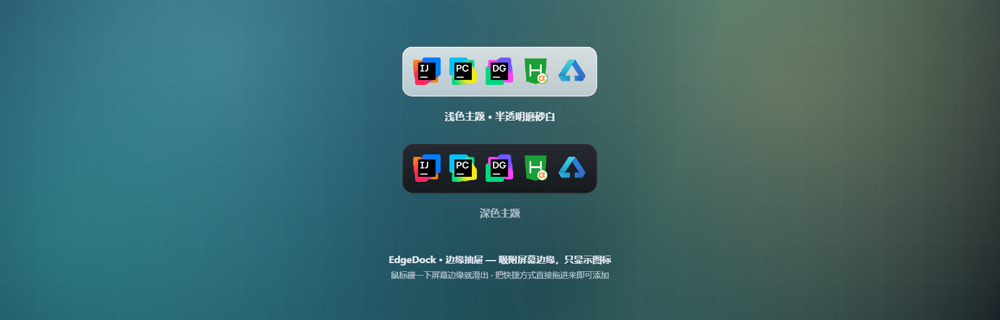

# EdgeDock · 边缘抽屉

> 把桌面上那一排常用软件图标收进一条**吸附在屏幕边缘的抽屉**。  
> 平时只是一道几像素的光痕，鼠标碰到屏幕边缘才滑出来；展开后**只显示图标**，移开就自动收回。

```
  收起时   ▔▔▔▔▔▔▔▔▔▔▔▔▔▔▔▔▔▔▔▔▔▔▔▔▔▔▔▔▔▔▔▔▔▔▔▔▔▔▔▔▔▔   ← 几像素的琥珀橙光痕
  展开时   ╭──────────────────────────────────────────╮
           │  IJ   PC   DG   VS   VM   🟠   AI   Ps   │   ← 只有图标，没有文字和背景板
           ╰──────────────────────────────────────────╯
```

Windows 桌面小工具 · PySide6 实现 · 绿色免安装 · 全中文注释



---

## 一句话概括

桌面上那些快捷方式，与其摊成一片，不如**收进屏幕边缘的一条抽屉里**。  
要的时候就碰一下屏幕边缘，它滑出来；不要的时候它只是一道几乎看不见的光痕，而且是**鼠标穿透**的  
——点击会直接落到下面的窗口上，不会挡住任何东西。

---

## 核心特性

### 一、贴边唤出，鼠标穿透

- 吸附在屏幕**上 / 下 / 左 / 右**四边任选一边，沿边位置可居中、靠起点或靠终点，还能整体偏移微调
- 收起时窗口是**鼠标穿透**的，只有那条光痕可见，不影响下面任何窗口的操作
- 触发区厚度、停留判定（防止鼠标划过就弹出）、自动收起延时都可调
- 光痕厚度可以调到 **0**，完全隐形，纯靠鼠标碰边唤出

### 二、图标数量不固定

- 想放多少个放多少个，装不下时自动出现滚动（滚轮即可翻）
- 图标取自 Windows Shell 的「超大图标列表」（**256×256**），在 150% / 200% 缩放下依旧锐利，  
  和桌面上的图标是同一套图源
- 首次启动会扫描桌面（用户桌面 + 公共桌面）的快捷方式，自动挑出常用开发工具

### 三、拖进去就能用

- 在桌面按住快捷方式 / 程序 / 文件夹，**拖到抽屉吸附的那条屏幕边缘**——抽屉自动滑出并高亮，松手即加入
- 重复拖同一个不会重复添加，托盘会提示

### 四、直接在抽屉里拖着排序

- 按住某个图标拖到想放的位置再松手，**松手即换位**，顺序立刻落盘
- 被拿起的图标会抬起（投影 + 高亮描边），空出来的位置是琥珀橙虚线凹槽，旁边的图标实时让位
- 只有**单击**（没有移动）才是启动程序，两者不会打架
- 图标太多拖到面板两端时会自动滚动，可以一路拖到队首 / 队尾

### 五、设置面板一屏放得下

- **左右两列**布局：左列调参数（吸附位置 / 外观 / 交互），右列管内容（应用列表 / 启动）
- 所有项**即时生效**，不需要重启
- 设置窗口自带**最小化按钮**：一边改参数一边要腾地方时最小化就行，不必关掉再重开

### 六、主题跟随系统

- 三档选择：**跟随系统 / 深色 / 浅色**
- 选「跟随系统」后，Windows 的「应用模式」在深色/浅色之间切换时，**抽屉与设置窗口即时跟着换**，  
  不用重启，也不用回来改设置
- 深色是「墨黑 + 琥珀橙」，浅色是**半透明磨砂白**（能透出壁纸层次）

### 七、其它

- 全局快捷键唤出 / 收起（默认 `Ctrl + Alt + D`，可在设置里改或禁用）
- 托盘图标常驻，左键切换抽屉、右键是主菜单；可设开机自启
- 单实例保护：重复启动只会提示「已经在运行了」，不会起两份
- 绿色版：所有配置就在程序目录的 `config.json`，删掉即恢复默认

---

## 快速开始

1. 双击 **`启动 EdgeDock.vbs`**（静默启动，不弹黑窗口）
2. 首次启动会自动扫描桌面、挑一批常用工具放进抽屉，并在托盘弹一条提示
3. 鼠标移**到屏幕顶部**（默认吸附在顶部）停一下，抽屉就滑出来了

> 自动挑得不对？右键托盘图标 → **「设置…」** → **从桌面挑选…**，自己勾。  
> 想开机就自动运行：托盘右键 → 勾上「开机自动启动」。

---

## 操作速查

| 操作               | 效果                                            |
| ---------------- | --------------------------------------------- |
| 鼠标碰一下吸附的那条屏幕边    | 抽屉滑出                                          |
| 鼠标移开抽屉           | 约 0.7 秒后自动收回                                  |
| 左键单击图标           | 启动程序，然后抽屉自动收起                                 |
| 悬停在图标上           | 图标放大 + 浮出程序名                                  |
| 右键单击图标           | 打开 / 打开文件所在位置 / 移到最前 / 移到最后 / 从抽屉移除 / 设置 / 退出 |
| 右键单击抽屉空白处        | 固定展开 / 设置 / 退出                                |
| 滚轮               | 图标太多时滚动                                       |
| 按住图标拖到别处         | 图标跟着走，松手即换位                                   |
| 从桌面拖快捷方式到屏幕边缘    | 抽屉自动滑出并高亮，松手即加入                               |
| `Ctrl + Alt + D` | 唤出 / 收起抽屉                                     |
| 左键单击托盘图标         | 唤出 / 收起抽屉                                     |
| 右键单击托盘图标         | 主菜单                                           |

---

## 设置面板能调什么

| 分组     | 内容                                             |
| ------ | ---------------------------------------------- |
| 吸附位置   | 顶部 / 底部 / 左侧 / 右侧；沿边居中、靠起点或靠终点；整体偏移            |
| 外观     | 图标大小 28–62px、面板不透明度、主题（跟随系统 / 深色 / 浅色）         |
| 交互     | 光痕厚度、触发区厚度、停留判定、自动收起延时、悬停浮出名称、启动后自动收起、全局快捷键    |
| 抽屉里的应用 | 增删、上下移动、拖拽列表排序、从桌面批量勾选、直接拖 `.lnk` / `.exe` 进列表 |
| 启动     | 开机自启、打开程序目录、打开配置文件                             |


深色主题下的样子见 `assets/设置页面-深色.png`。

---

## 技术实现

| 项                | 说明                                                                                                |
| ---------------- | ------------------------------------------------------------------------------------------------- |
| 语言 / 框架          | Python 3.13 + PySide6 6.9.3（Qt 6.9.3）                                                             |
| Win32 / Shell 交互 | 纯 `ctypes` 直调，**不依赖 pywin32**；含 `IShellLinkW` / `IImageList` 等 COM 接口                             |
| 图标提取             | `SHGetFileInfoW` → `SHGetImageList(SHIL_JUMBO)` → `IImageList::GetIcon`，另存 256×256 PNG 磁盘缓存（后台线程） |
| 窗口特效             | 分层窗口 + `WS_EX_TRANSPARENT` 鼠标穿透、`WS_EX_TOOLWINDOW` 不出现在 Alt+Tab、`DwmSetWindowAttribute` 深色标题栏     |
| 全局快捷键            | 轮询 `GetAsyncKeyState` 实现（不用 `RegisterHotKey`，不独占组合键）                                              |
| 主题跟随系统           | Qt 6.5+ `styleHints().colorScheme()` 优先，退回读注册表 `AppsUseLightTheme`                                |
| 单实例              | 命名互斥体                                                                                             |
| 代码规模             | 应用本体 8 个模块，约 2900 行（全中文注释）                                                                        |

运行环境已固化在项目目录的 `.venv` 里，换机器或环境损坏时双击 **`安装运行环境.bat`** 重建。

---

## 目录结构

```
EdgeDrawer\
├─ 启动 EdgeDock.vbs        ← 双击这个（静默启动）
├─ 调试运行.bat              ← 想看到报错信息时用它
├─ 安装运行环境.bat          ← 换机器 / 环境损坏时重建 .venv
├─ main.pyw                 入口（13 行）
├─ README.md                完整说明
├─ 简介.md                  本文
├─ config.json              全部设置与图标列表（绿色版）
├─ edgedock\
│   ├─ app.py               托盘 / 全局快捷键 / 开机自启 / 单实例
│   ├─ drawer.py            抽屉窗口、滑出动画、图标按钮、名称浮标、拖动排序
│   ├─ settings.py          设置面板、从桌面挑选应用
│   ├─ icons.py             图标提取与磁盘缓存（后台线程）
│   ├─ winapi.py            Win32 / Shell 封装（ctypes）
│   ├─ theme.py             深色 / 浅色配色，以及「跟随系统」的解析
│   └─ config.py            配置读写、首次运行自动挑应用
├─ tools\                   辅助与自检脚本
├─ assets\                  图标与截图
└─ cache\icons\             图标缓存（可随意删除）
```

---

## 边界与已知限制

- **仅支持 Windows**：大量依赖 Win32 / Shell API，没有跨平台计划
- 快捷键选项里的「Alt + 反引号」这一项无法解析（反引号不在可解析的按键表内），选中后快捷键会静默失效  
  ——属于既有问题，改用其它组合即可
- 目前是「Python 源码 + 内置虚拟环境」的形态；需要**不需要 Python 的单个 exe** 可以用 PyInstaller 打包  
  （体积约 80–120 MB）

---

*本文是简要介绍；更完整的使用说明、自检脚本用法与常见问题见 [README.md](README.md)。*
